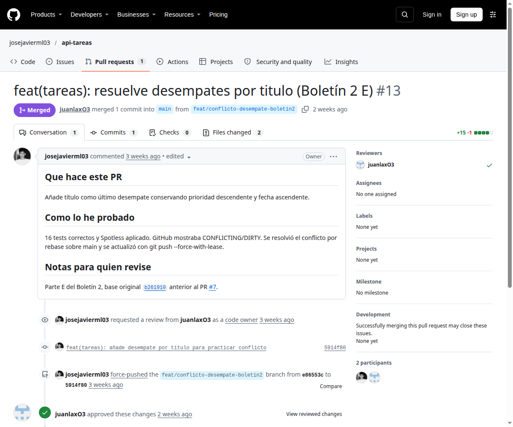
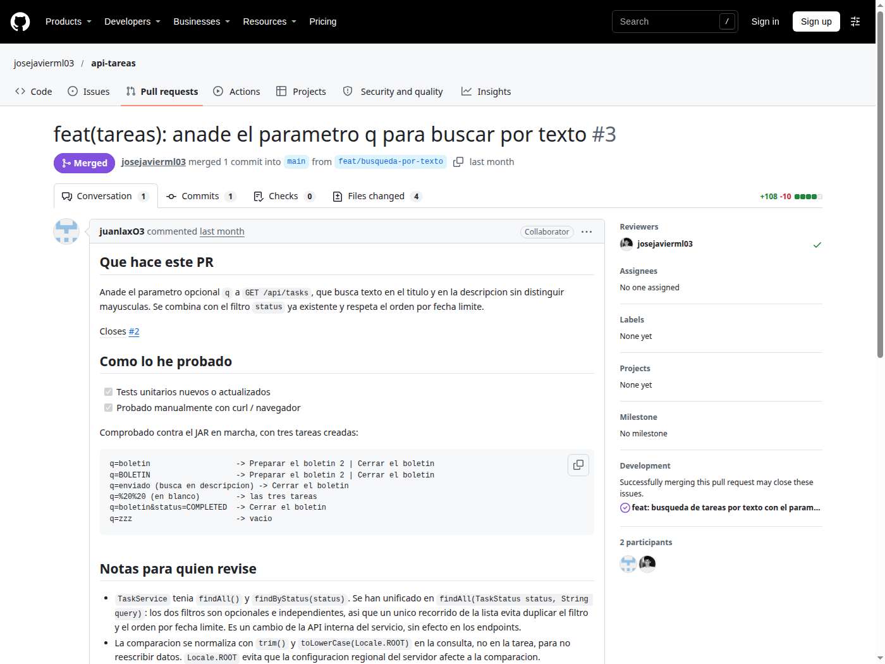
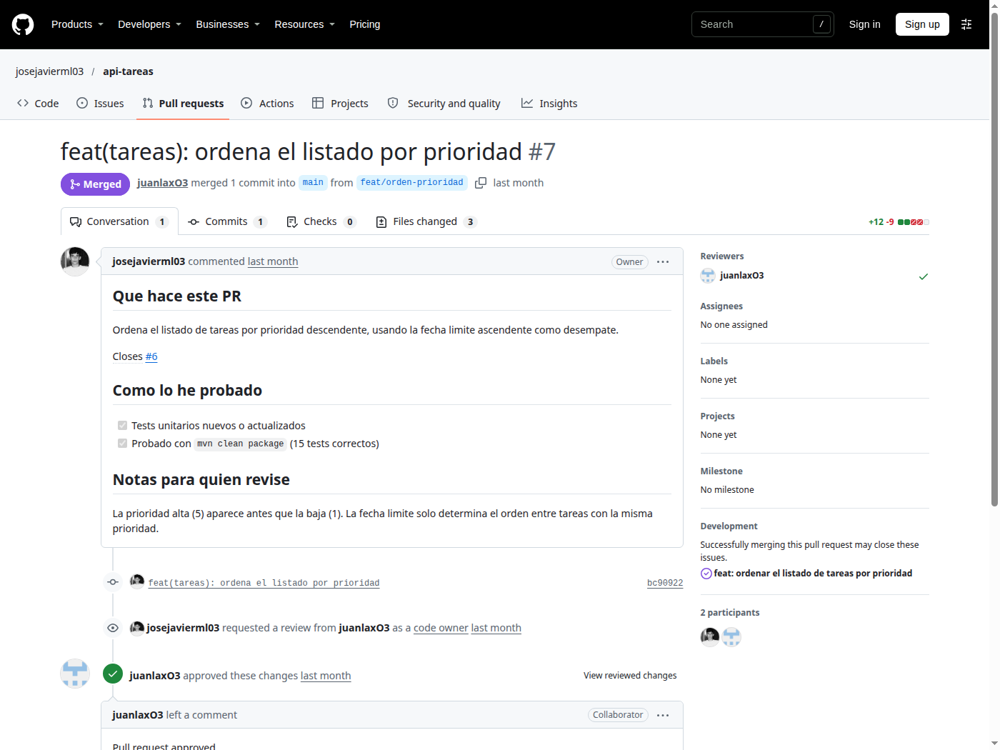
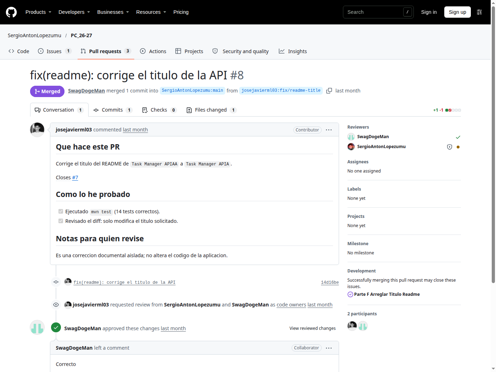
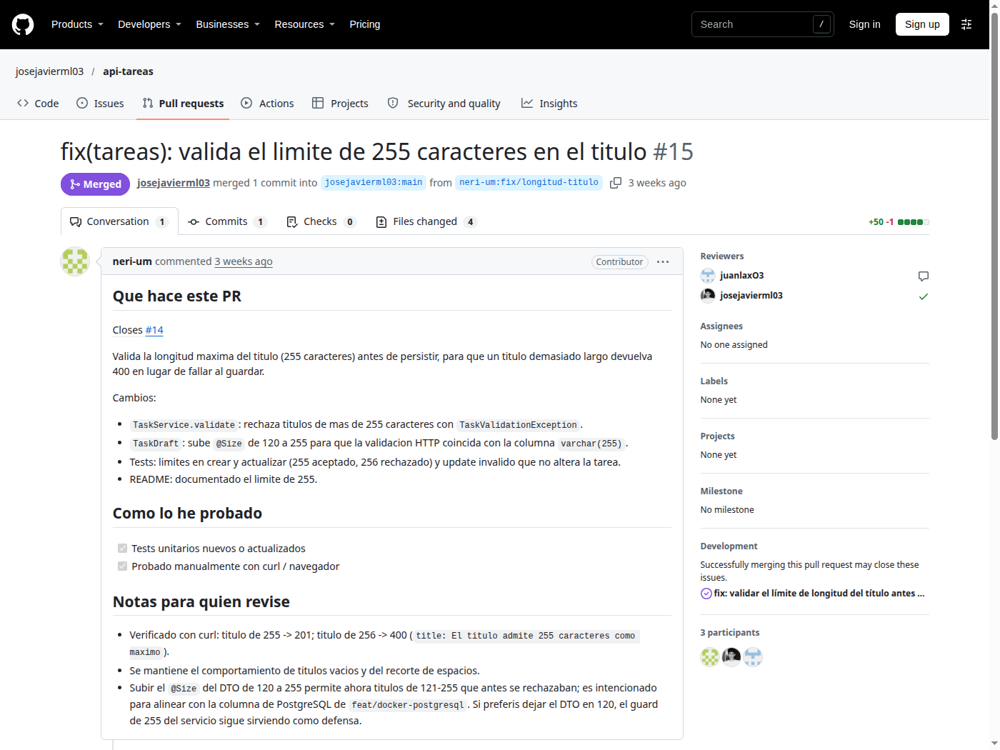
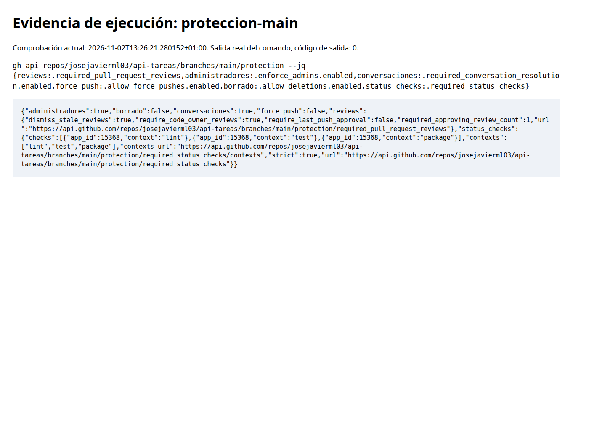
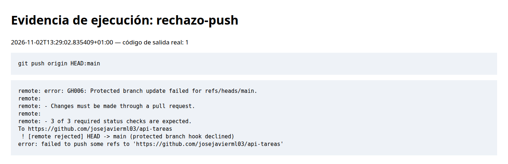

# Boletín 2: GitHub y colaboración con Pull Requests

Repositorio: <https://github.com/josejavierml03/api-tareas>. Memoria integrada a partir de `memoria-boletin2.md`, con las actualizaciones verificadas posteriores.

## Resumen de commits y PR

| Cambio | Descripción y parte | Autor del PR | Enlace |
|---|---|---|---|
| `chore(github): añade gobernanza del repositorio` (`6819a50`) | README, plantillas, CODEOWNERS, CONTRIBUTING; A–B | José Javier Méndez | [PR #1](https://github.com/josejavierml03/api-tareas/pull/1) |
| `feat(tareas): anade el parametro q para buscar por texto` (`b261910`) | Búsqueda por texto; D | juanlaxO3 | [PR #3](https://github.com/josejavierml03/api-tareas/pull/3) |
| `feat(tareas): ordena el listado por prioridad` (`c9ebc18`) | Orden por prioridad; D | José Javier Méndez | [PR #7](https://github.com/josejavierml03/api-tareas/pull/7) |
| `feat(tareas): añade desempate por titulo para practicar conflicto` (`5914f80`) | Conflicto y rebase, desempate por título y test; E | José Javier Méndez | [PR #13](https://github.com/josejavierml03/api-tareas/pull/13) |
| `fix(tareas): valida el limite de 255 caracteres en el titulo` (`24b4981`) | Validación del título desde fork; F | neri-um | [PR #15](https://github.com/josejavierml03/api-tareas/pull/15) |
| `fix(readme): corrige el titulo de la API` (`14d16be`) | Corrección documental desde fork, aprobada y fusionada; F | José Javier Méndez | [PR externo #8](https://github.com/SergioAntonLopezumu/PC_26-27/pull/8) |

## Detalle de los commits de la memoria original

### 1. `chore(github): añade gobernanza del repositorio`

- **Qué se hizo:** plantilla de PR, plantillas bug/enhancement, CODEOWNERS para ambos compañeros, CONTRIBUTING y README con clonado, requisitos, compilación, arranque y hooks.
- **Autor:** José Javier Méndez.
- **Relación:** partes A–B; seis archivos integrados por squash como [37eb919](https://github.com/josejavierml03/api-tareas/commit/37eb91998e842f5313125a0445a85822b3b415b7) tras aprobación de `juanlaxO3`.
- **IA declarada en el original:** OpenCode, GPT-5.6-terra. Petición: «Dentro de la carpeta api-tareas, haz las tres primeras partes del boletin». Se revisaron archivos, colaboradores y configuración remota.

### 2. `feat(tareas): anade el parametro q para buscar por texto`

- **Qué se hizo:** `q` busca sin distinguir mayúsculas en título y descripción y combina con `status`. Se unificó la consulta en `findAll(TaskStatus status, String query)`, se añadieron seis tests y se actualizó README.
- **Autor:** Juan Antonio Cortado Lax (`juanlaxO3`). Commit de desarrollo [aacf565](https://github.com/josejavierml03/api-tareas/commit/aacf565737f5651f815ec0fbfd1d1793963dce92), integrado como `b261910`.
- **Relación:** parte D, Issue #2 y PR #3 con plantilla y revisión de José Javier.
- **IA declarada:** OpenCode, modelo big-pickle. El original no especifica el prompt de este cambio; queda pendiente completarlo por su autor.

### 3. `feat(tareas): ordena el listado por prioridad`

- **Qué se hizo:** prioridad descendente, fecha ascendente como desempate, test de ambas reglas y README actualizado.
- **Autor:** José Javier Méndez. Commit de desarrollo [bc90922](https://github.com/josejavierml03/api-tareas/commit/bc90922), integrado como `c9ebc18`.
- **Relación:** parte D con roles invertidos; Issue #6 con etiqueta enhancement y PR #7 desde `feat/orden-prioridad`, aprobado por Juan Antonio.
- **IA declarada:** OpenCode, GPT-5.6-terra. Petición: «Revisa el directorio, y haz las partes que falten del segundo boletin». Se revisaron código, test y `mvn clean package`.

### 4. `fix(readme): corrige el titulo de la API`

- **Qué se hizo:** corrección de `Task Manager APIAA` a `Task Manager APIA` en el fork `josejavierml03/PC_26-27`, rama `fix/readme-title`.
- **Autor:** José Javier Méndez.
- **Relación:** parte F; resolvió el Issue externo #7 mediante PR #8 desde un fork. `SwagDogeMan` aprobó el PR, que fue fusionado el 5 de octubre de 2026. El cambio consistió en corregir un título del README; el enunciado solicita un issue no trivial, por lo que su suficiencia para ese requisito queda a criterio del profesorado.
- **IA declarada:** OpenCode, GPT-5.6-terra, bajo la misma petición anterior. Se revisó el diff aislado y se ejecutaron 14 tests del fork correctamente.

## Desarrollo por partes

### A–B

Repositorio público y colaborador `juanlaxO3`. Las plantillas de bug/mejora aplican etiquetas y el PR guía descripción, pruebas y revisión. CODEOWNERS asigna la aplicación a ambos compañeros y su análisis devolvió cero errores. Squash merge agrupa cada PR en un commit significativo.

### C

`main` exige PR, una aprobación, Code Owners, conversaciones resueltas, descarta aprobaciones obsoletas y aplica reglas a administradores. No permite force push ni borrado. El commit temporal `3600388` se intentó enviar con `git push origin HEAD:main`; GitHub respondió `GH006` y `Changes must be made through a pull request`. Nunca se integró el comentario de prueba.

La memoria original documenta además una prueba anterior en `main`, también rechazada con GH006, cuyo commit temporal se descartó después. Son dos comprobaciones distintas, ambas sin cambios de prueba integrados. Los PR #1 y #3 aparecían `BLOCKED/REVIEW_REQUIRED` antes de la aprobación. La cuenta `juanlaxO3` tiene push pero no administración, por lo que la captura de Settings → Branches corresponde al propietario.

### D

Los PR #3 y #7 se aprobaron y fusionaron con intercambio de roles: José Javier revisó la búsqueda de Juan Antonio y Juan Antonio revisó la ordenación de José Javier.

La memoria original conserva estas pruebas manuales contra el JAR:

```text
q=boletin -> Preparar el boletin 2 | Cerrar el boletin
q=BOLETIN -> mismos resultados
q=enviado -> Cerrar el boletin (coincidencia en descripción)
q=%20%20 -> las tres tareas, sin filtro de texto
q=boletin&status=COMPLETED -> Cerrar el boletin
q=zzz -> vacío
```

Los Issues #2 y #6 se enlazaron desde sus PR con `Closes`, se cerraron tras el squash y se eliminaron las ramas después de la fusión.

### E

Se creó una rama desde `b261910` con un cambio en el mismo comparador modificado por #7. El PR #13 mostró `CONFLICTING/DIRTY`. `git rebase main` produjo conflicto real; se combinaron prioridad descendente, fecha ascendente y título. Tras pasar 16 tests y `git push --force-with-lease`, pasó a `MERGEABLE`. El PR ya está fusionado.



### F

El Issue #14 y PR #15 aportan validación desde el fork de otro grupo y están cerrados/fusionados. Como evidencia de nuestra colaboración en el repositorio de otra pareja se utiliza el [PR externo #8](https://github.com/SergioAntonLopezumu/PC_26-27/pull/8), abierto desde un fork, aprobado por `SwagDogeMan` y fusionado. La modificación fue una corrección del título del README; el boletín solicita un issue no trivial.

## Uso de IA

Las declaraciones originales de IA se conservan en cada detalle de commit. Para la prueba posterior de protección y el conflicto se utilizó OpenCode, GPT-6.1-sol, bajo «Haz aquello que falte de la 2 y haz el boletin 3». Se verificaron resolución y tests.

## Capturas de comprobación

Capturas actuales obtenidas el 2 de noviembre de 2026, sustituyendo las referencias a imágenes no aportadas. Los PR #3, #7 y #8 ya están fusionados; no se presenta su estado actual como si fuera el antiguo estado pendiente.







El PR #15 demuestra la contribución de código recibida desde otro grupo:



La siguiente captura muestra la salida real de la API de GitHub, presentada en una vista de evidencias (no es una captura de Settings). Incluye protección, aprobación, Code Owners y checks obligatorios:



Se repitió el intento de push con el commit temporal `6fba6c7`, basado en `main` actual y creado en un worktree separado. GitHub lo rechazó con GH006 y con la exigencia de los tres checks; el comentario de prueba nunca llegó a main:



La captura del PR #13 de la parte E muestra la resolución, el force-with-lease y la aprobación en su historial. El estado visual antiguo de conflicto previo al rebase no se ha recuperado.
