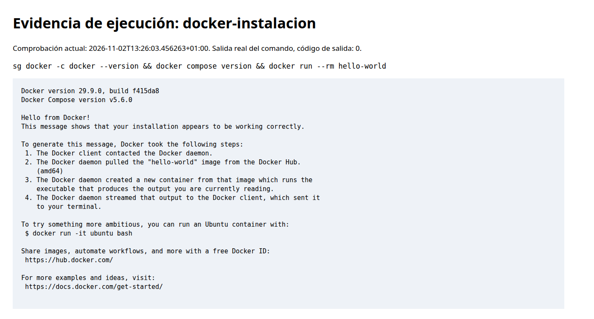
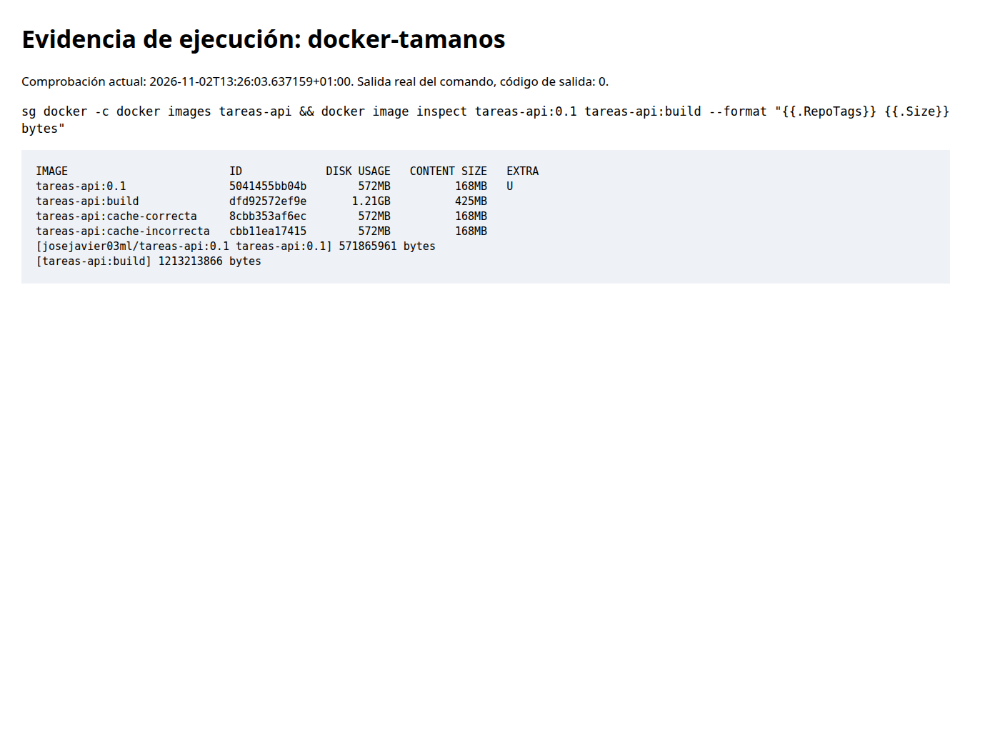
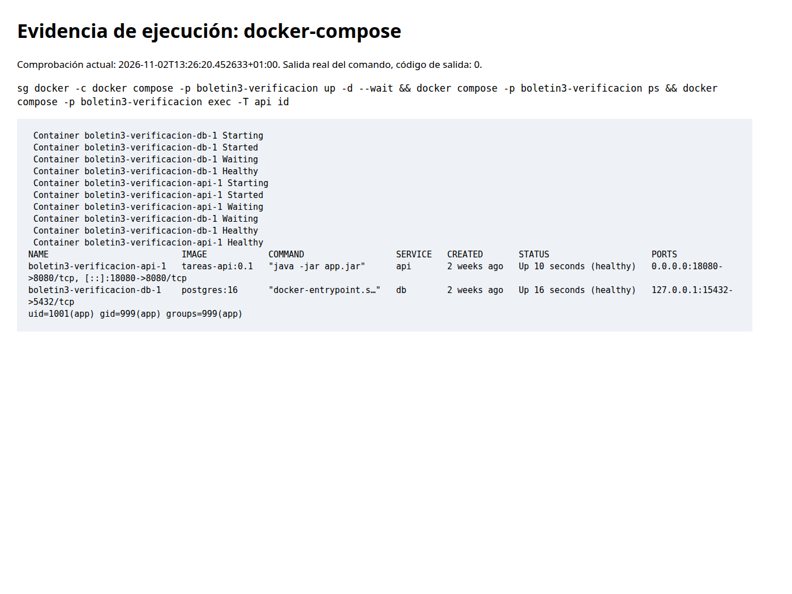
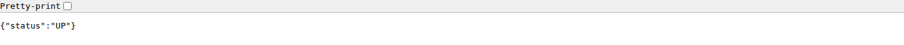
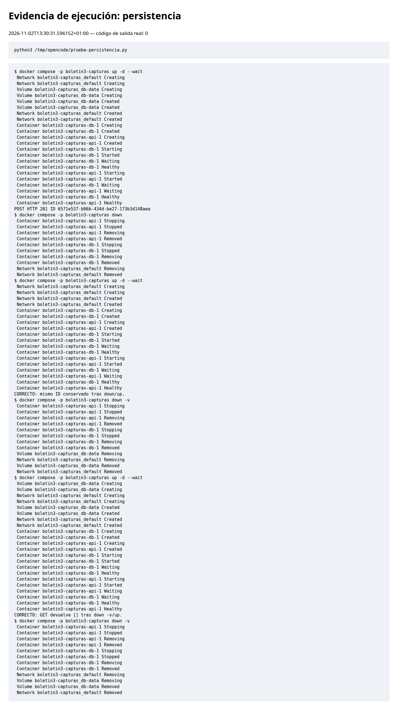
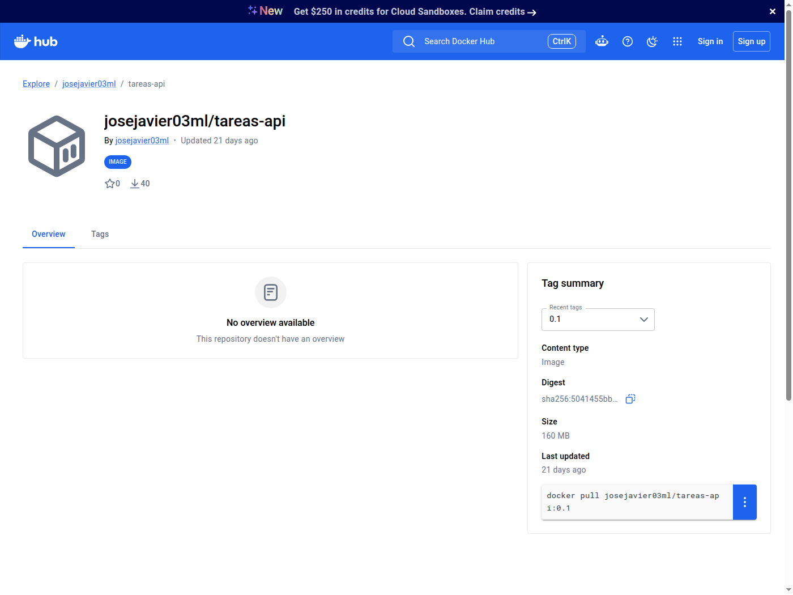
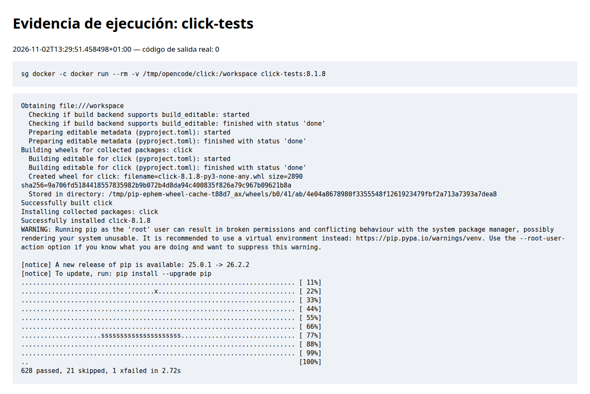

# Boletín 3: Docker — contenerizar la aplicación

Repositorio: <https://github.com/josejavierml03/api-tareas>. Memoria integrada a partir de `memoria-boletin3.md`, conservando las comprobaciones posteriores del dev container y el estado actual del PR.

## Resumen de commits

| Mensaje | Qué se hizo | Autor | Enlace |
|---|---|---|---|
| `feat(docker): incorpora PostgreSQL y entorno contenerizado` | Actuator, JPA/PostgreSQL, Dockerfile multi-stage, Compose, entorno y tests | José Javier Méndez | [f8caeb5](https://github.com/josejavierml03/api-tareas/commit/f8caeb5) |
| `fix(docker): permite configurar los puertos locales` | Puertos locales configurables | José Javier Méndez | [0bdada5](https://github.com/josejavierml03/api-tareas/commit/0bdada5) |

## Detalle y relación con el boletín

### 1. `feat(docker): incorpora PostgreSQL y entorno contenerizado`

- **Qué se hizo:** Actuator y Spring Data JPA, driver PostgreSQL, entidad persistente y adaptador que conserva el contrato del repositorio. Dockerfile multi-stage, Compose, `.dockerignore`, `.env.example`, propiedades y dev container. El servicio real usa JPA y los tests de negocio memoria. Se añadieron tres tests unitarios de conversión de campos y eliminación de entidades existentes/ausentes.
- **Autor:** José Javier Méndez.
- **Relación:** partes B–G.
- **IA:** OpenCode, GPT-6.1-sol. Petición: «Haz aquello que falte de la 2 y haz el boletin 3. Dame los comandos a ejecutar para instalar docker». Artefactos revisados y comprobaciones Maven y Docker ejecutadas.

### 2. `fix(docker): permite configurar los puertos locales`

- **Qué se hizo:** variables `POSTGRES_PORT` y `API_PORT` en Compose, plantilla y documentación, con valores predeterminados 5432/8080.
- **Autor:** José Javier Méndez.
- **Relación:** partes D–E, configuración local sin cambios de código; 5432 estaba ocupado y se utilizaron 15432/18080.
- **IA:** OpenCode, GPT-6.1-sol, continuación tras «Listo». Se validaron configuración y arranque saludable.

## Descripción de la sesión

### A — Instalación

Ubuntu 24.04 con Docker Engine 29.9.0 y Compose v5.6.0 instalados desde el repositorio oficial. `docker run --rm hello-world` mostró «Hello from Docker!». La sesión anterior al cambio de grupo utilizó `sg docker -c 'comando'`. Docker Desktop no se ha instalado; el original enlaza su [instalación oficial](https://docs.docker.com/desktop/setup/install/linux/ubuntu/).

### B — Endpoint de salud

Actuator expone únicamente `health` e `info` y restringe los detalles de salud a usuarios autorizados. La salud incluye PostgreSQL. `curl -f http://localhost:18080/actuator/health` devolvió `{"status":"UP"}` y ambos servicios aparecieron healthy. `docker compose exec -T api id` confirmó `uid=1001(app)`.

### C — Dockerfile multi-stage

La primera etapa usa Maven 3.9 y JDK 21. Descarga dependencias tras copiar `pom.xml`, antes de `src`. La final usa JRE 21, copia solo el JAR, se ejecuta como app (UID 1001) y usa curl para su healthcheck. `.dockerignore` excluye Git, compilación, memorias y `.env`.

Ambas etapas se construyeron con:

```bash
docker build -t tareas-api:0.1 .
docker build --target build -t tareas-api:build .
docker images tareas-api
```

`docker image inspect` dio 571.865.961 bytes (runtime) y 1.213.213.866 bytes (build), con contenidos comprimidos de 168 y 425 MB. Build incluye Maven, compilador, fuentes y caché que el runtime no necesita.

Para la caché se modificó temporalmente un comentario en `Task.java`. El orden correcto tardó **7,72 s** reutilizando `dependency:go-offline`. Se calentó la caché de un Dockerfile temporal en `/tmp/opencode` con `COPY src` antes del pom, se volvió a modificar el comentario y se midieron **36,94 s**: la descarga volvió a ejecutarse (29,4 s). Se restauraron el código y el orden correctos. Los tiempos dependen del equipo y la red.

### D — PostgreSQL y Compose

La API usaba `ConcurrentHashMap`, no H2, por lo que se incorporó JPA/Hibernate además del driver PostgreSQL. `ddl-auto=update` crea/actualiza la tabla. PostgreSQL 16 usa un volumen nombrado; api espera el healthcheck `pg_isready` y hereda su propio healthcheck del Dockerfile.

POST devolvió 201 y creó `51059ec0-f232-4d1b-b06a-648b9cb47b30`. Se recuperó el mismo ID tras `down` y `up -d --wait`. Tras `down -v` y nuevo arranque, GET devolvió `[]`. `down` elimina contenedores/red; `-v` elimina además el volumen. La prueba usó el proyecto aislado `boletin3-verificacion`.

### E — Variables de entorno

`.env.example` se versiona, `.env` no llega a Git ni al contexto de build. `${VAR}` se sustituye desde Compose; `${VAR:?mensaje}` exige un valor no vacío; `${VAR:-valor}` fija un predeterminado; `$${VAR}` delega la expansión al shell del contenedor. PostgreSQL usa las credenciales solo al inicializar el volumen.

Se validó la configuración, los puertos locales 15432/18080 y la conexión correcta entre API y base de datos sin versionar credenciales.

### F — Dev container

- `name` identifica el entorno y `image` establece la base Java 21.
- `features` añade Maven y Docker-in-Docker, cuyo daemon permite ejecutar Compose dentro del entorno.
- `forwardPorts` reenvía los puertos de API y PostgreSQL.
- `postCreateCommand` prepara `.env` si falta, activa `.githooks` y descarga dependencias Maven.
- `customizations` instala extensiones Java/Docker en VS Code.

El original dejaba pendiente su ejecución, que se completó por CLI como se detalla a continuación. La apertura visual en VS Code no se ha comprobado; su uso es opcional según el enunciado.

### G — Versionado

Los cambios se publicaron desde `feat/docker-postgresql` y el [PR #12](https://github.com/josejavierml03/api-tareas/pull/12) ya está fusionado, aunque el original todavía lo marcaba pendiente. README documenta Compose, JAR y dev container.

## Verificación adicional del dev container

En la sesión de cierre se construyó y arrancó el dev container con `@devcontainers/cli@0.80.1`. Se detectó que la feature Java sin versión explícita instalaba la última versión disponible; se fijaron `version=21`, `jdkDistro=tem` y Maven 3.9.9. Se añadieron los puertos alternativos al reenvío de VS Code.

Se ejecutaron postCreateCommand, Docker-in-Docker y `docker compose -p boletin3-devcontainer up --build -d --wait` dentro del entorno: Java Temurin 21.0.13, Maven 3.9.9, API y PostgreSQL saludables, `curl http://localhost:18080/actuator/health` devolvió UP. La prueba fue por CLI; no se afirma haber abierto VS Code visualmente. Las primeras invocaciones de creación agotaron el timeout tras arrancar el contenedor, y se completó con `--expect-existing-container`.

## Comprobaciones realizadas

- Docker Engine 29.9.0, Compose v5.6.0 y hello-world correctos. Se instaló Engine; Desktop no se ha comprobado.
- API y PostgreSQL saludables; `/actuator/health` devuelve UP; usuario UID 1001.
- POST 201; tarea conservada tras down/up y listado vacío tras down -v/up, en proyecto aislado `boletin3-verificacion`.
- Runtime 571.865.961 bytes; build 1.213.213.866 bytes. Maven, JDK y caché solo permanecen en build.
- Caché medida: 7,72 s copiando pom antes de src frente a 36,94 s invirtiendo el orden; la segunda invalida las dependencias. Se restauró el código temporal.
- Maven: 18 tests correctos en esa sesión, package y Spotless correctos.
- [PR #12](https://github.com/josejavierml03/api-tareas/pull/12) fusionado.

## H — Registro

Imagen [josejavier03ml/tareas-api](https://hub.docker.com/r/josejavier03ml/tareas-api), etiqueta `0.1`. Se ejecutaron login, tag, push y pull. Digest `sha256:5041455bb04bbc62f0e26fca11cde3426c56430a0042ee487ed909b2ee699c57`.

```bash
docker login
docker tag tareas-api:0.1 josejavier03ml/tareas-api:0.1
docker push josejavier03ml/tareas-api:0.1
docker pull josejavier03ml/tareas-api:0.1
```

El namespace se normalizó a minúsculas, como exige Docker; esta parte no modificó el repositorio.

## I — Tests de proyecto externo

Click 8.1.8, commit `934813e4d421071a1b3db3973c02fe2721359a6e`. Requisitos consultados en su pyproject.toml y requirements/tests.in: Python >=3.7, flit_core<4 y pytest. Se montó el código en `/workspace`, instaló editable y ejecutó pytest dentro de Python 3.12 con pytest 8.3.5/flit_core 3.10.1. Resultado: **628 passed, 21 skipped, 1 xfailed**, salida 0. Los artefactos de este ejercicio se mantuvieron fuera del repositorio. El enunciado disponible está truncado al final de esta parte.

Fuentes: [pyproject.toml](https://github.com/pallets/click/blob/8.1.8/pyproject.toml) y [requirements/tests.in](https://github.com/pallets/click/blob/8.1.8/requirements/tests.in). El original sitúa el Dockerfile de pruebas en `Downloads/boletin3-pruebas/Dockerfile` y registra estos comandos:

```bash
git clone --depth 1 --branch 8.1.8 https://github.com/pallets/click.git click
docker build -t click-tests:8.1.8 .
docker run --rm -v "$PWD/click:/workspace" click-tests:8.1.8
```

La suite tardó 1,96 s; las omisiones y el fallo esperado son los que marca Click. No se eliminaron pruebas para obtener el resultado.

## Uso de IA y capturas

Se conservan las declaraciones originales de IA de cada commit y las pruebas posteriores de la sesión de cierre. El documento original ya está incorporado.

## Capturas de comprobación

Capturas actuales del 2 de noviembre de 2026. Las salidas de comandos se muestran en una vista de evidencias con fecha y código de salida reales; no se simula una terminal ni la fecha de la sesión original.









Para obtener la evidencia de persistencia se repitió el experimento en un proyecto aislado `boletin3-capturas`, puertos 18084/15434: POST 201, mismo ID tras down/up y lista vacía tras down -v/up. Después se limpiaron solo los contenedores y volúmenes de esa prueba:





Los tests de Click se repitieron sobre el mismo commit con el código montado desde `/tmp/opencode/click`: **628 passed, 21 skipped, 1 xfailed en 2,72 s** (salida 0). Este tiempo corresponde a la repetición, frente a 1,96 s de la ejecución original:


