# Boletín 4: Integración Continua con GitHub Actions

## Ampliación del cierre

En [d4c7d70](https://github.com/josejavierml03/api-tareas/commit/d4c7d70), José Javier Méndez ajustó el paso del informe para que los PR desde forks no intenten escribir checks con un token de solo lectura. El resultado JUnit se conserva siempre como artefacto, incluso si no se puede publicar el check. Uso de IA: OpenCode GPT-6.1-sol, «Implementa todo lo que falta de los boletines». Se verificaron 24 tests, Spotless y los tres jobs del CI en verde en el PR #22.

Repositorio: <https://github.com/josejavierml03/api-tareas>.

## Resumen de commits

| # | Mensaje | Qué se hizo | Autor | Enlace |
|---|---|---|---|---|
| 1 | `ci: añade el pipeline de integración continua` | Primer workflow `ci.yml` con un único job que compila, testea y comprueba el formato. | Juan Antonio | [e142ff2](https://github.com/josejavierml03/api-tareas/commit/e142ff2) |
| 2 | `test: rompe una aserción para comprobar el CI` | Rompe a propósito una aserción de `TaskServiceTest`, observa el rojo del pipeline y la corrige reforzando el test. | Juan Antonio | [5389516](https://github.com/josejavierml03/api-tareas/commit/5389516) |
| 3 | `ci: separa el pipeline en lint, test y package` | Reestructura `ci.yml` en tres jobs encadenados con `needs`, informe JUnit y artefacto JAR. Incluye un commit intermedio con el formato desordenado para probar `lint`. | Juan Antonio | [75081c5](https://github.com/josejavierml03/api-tareas/commit/75081c5) |
| 4 | `test: rompe un test para comprobar la proteccion de main` | PR de verificación de la parte D. **No se fusionó**: se cerró tras capturar la evidencia. | Juan Antonio | [9d63a87](https://github.com/josejavierml03/api-tareas/commit/9d63a87) |
| 5 | `ci: revisa los pull requests con IA y anade badges` | Workflow `ai-review.yml` con revisión por IA en cada PR, manejo de errores y badges del README. | Juan Antonio | [b2ed0ed](https://github.com/josejavierml03/api-tareas/commit/b2ed0ed) |

Los commits 1, 2, 3 y 5 son los *squash* fusionados en `main`; el 4 no llegó a fusionarse. Debajo de cada uno hubo commits de desarrollo (ver detalle).

## Detalle por commit

### 1. `ci: añade el pipeline de integración continua` (parte A)

- **Qué se hizo:** se creó `.github/workflows/ci.yml` con un único job `build` que hace checkout, configura JDK 21 (Temurin) con caché de Maven y ejecuta `mvn --batch-mode verify`. Se ejecuta en cada push a `main` y en cada pull request. Se añadieron `concurrency` (agrupado por `github.ref` con `cancel-in-progress`) para cancelar ejecuciones obsoletas de la misma rama y `permissions: contents: read`, que es todo lo que necesita.
- **Autor:** Juan Antonio.
- **Relación con el boletín:** parte A.
- **Uso de IA:** OpenCode, modelo MiMo-V2.6-Pro. Petición: «Workflow de un solo job». Se comprobó en local `mvn -B verify` (24 tests) y `mvn -B spotless:check` antes de abrir el [PR #16](https://github.com/josejavierml03/api-tareas/pull/16).
- **Alcance de la consulta (elaboración, no cita literal):** crear un primer workflow de GitHub Actions que se active en los eventos del boletín, prepare JDK 21 y Maven con caché, ejecute la verificación del proyecto y limite sus permisos. También se revisó cómo usar `concurrency` para cancelar ejecuciones obsoletas.
- **Verificado:** run [40376918024](https://github.com/josejavierml03/api-tareas/actions/runs/40376918024) en verde en 26 s.

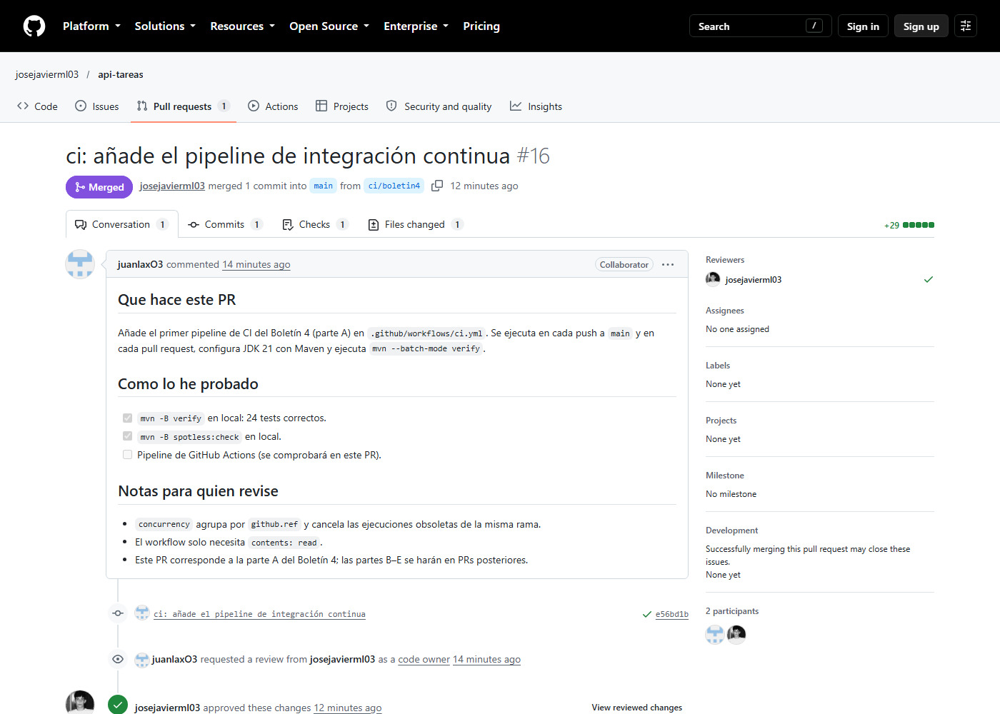

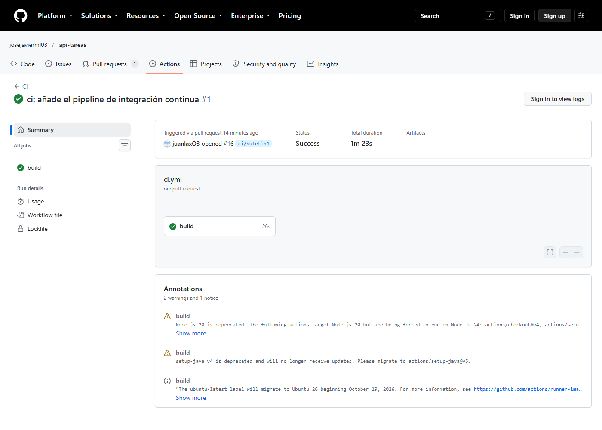

### 2. `test: rompe una aserción para comprobar el CI` (parte B)

- **Qué se hizo:** se cambió la aserción esperada de `TaskServiceTest.createsTaskWithGeneratedId` a `"Titulo incorrecto"` para que fallara. El pipeline se puso en rojo y se capturó el error. Después se restauró el valor correcto y se añadió `assertEquals(TaskStatus.PENDING, task.status())` para dejar la corrección con más valor que un simple *deshacer*.
- **Autor:** Juan Antonio.
- **Relación con el boletín:** parte B.
- **Verificado:**
  - Run rojo [40377556366](https://github.com/josejavierml03/api-tareas/actions/runs/40377556366): `TaskServiceTest.createsTaskWithGeneratedId:31 expected: <Titulo incorrecto> but was: <Preparar la practica>`, 24 tests con 1 fallo.
  - Run verde [40377845971](https://github.com/josejavierml03/api-tareas/actions/runs/40377845971): job `build` correcto en 14 s.

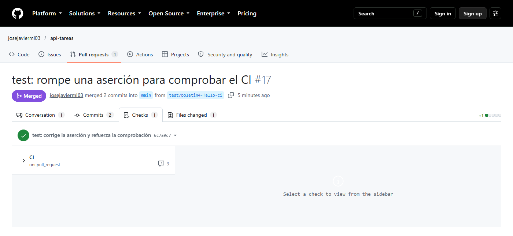

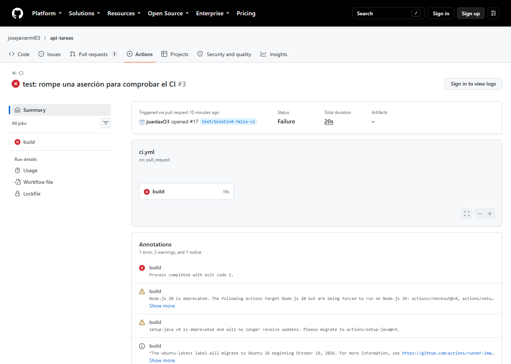

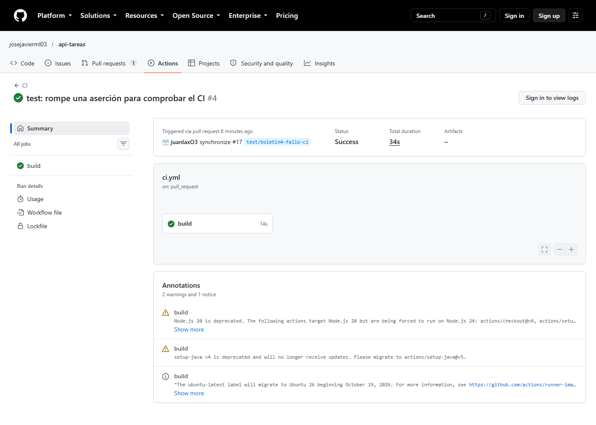

### 3. `ci: separa el pipeline en lint, test y package` (parte C)

- **Qué se hizo:** se reestructuró `ci.yml` en tres jobs encadenados con `needs` (`lint` → `test` → `package`), con los permisos `contents: read`, `actions: read` y `checks: write` que necesita `dorny/test-reporter@v3`. El job `test` publica el informe JUnit con `if: always()`. El job `package` construye el JAR con `-DskipTests` y lo sube con `actions/upload-artifact@v4` con retención de 7 días. Los commits internos fueron:
  - `2dc5c92` — reestructura el workflow.
  - `e9e785b` — desordena la indentación de `Task.java` y se salta el hook con `git commit --no-verify`.
  - `4e61e70` — aplica `mvn spotless:apply` y recupera el formato.
- **Autor:** Juan Antonio.
- **Relación con el boletín:** parte C.
- **Uso de IA:** OpenCode, MiMo-V2.6-Pro. Petición: «Reestructura el workflow». El workflow copia la estructura que pide el enunciado, incluidos los comentarios explicativos del bloque `permissions`.
- **Alcance de la consulta (elaboración, no cita literal):** separar formato, tests y empaquetado en los jobs `lint`, `test` y `package`, conectarlos mediante `needs`, publicar los resultados JUnit y guardar el JAR. La práctica incluía observar que un fallo de formato detiene los jobs posteriores y corregirlo después.
- **Verificado:**
  - Run rojo [40378550344](https://github.com/josejavierml03/api-tareas/actions/runs/40378550344): `lint` falla con `The following files had format violations: src/main/java/es/maxih/tareas/domain/Task.java` y `test` y `package` quedan en **skipped**.
  - Run verde [40378696333](https://github.com/josejavierml03/api-tareas/actions/runs/40378696333): `lint`, `test` y `package` correctos en 54 s, informe JUnit con **24 passed, 0 failed and 0 skipped** y artefacto `app-jar` de 47,4 MB.

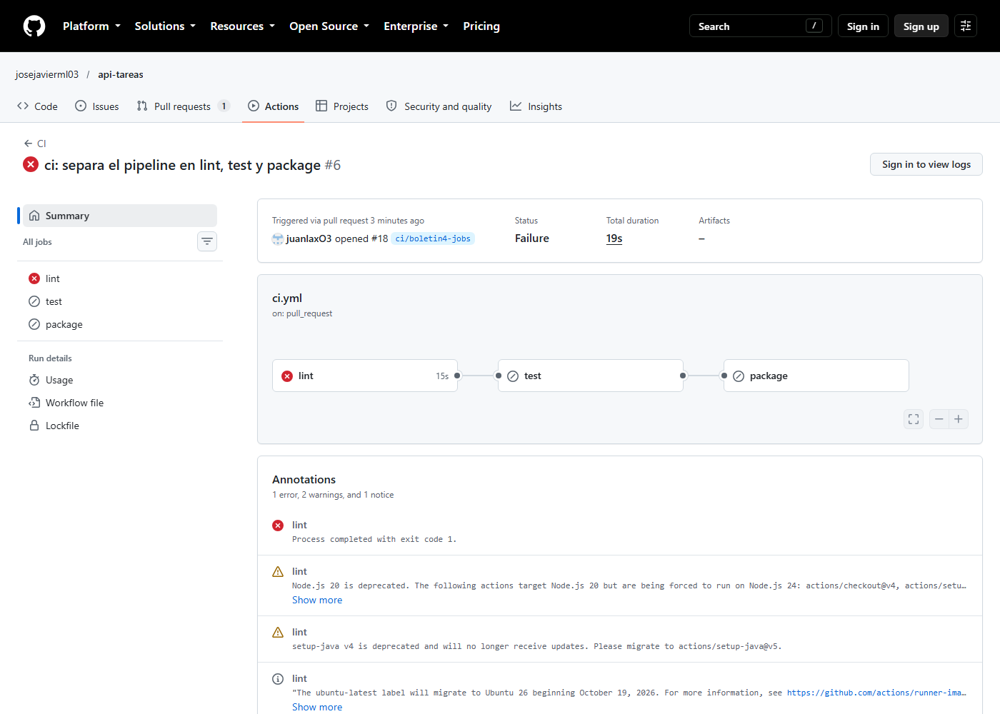

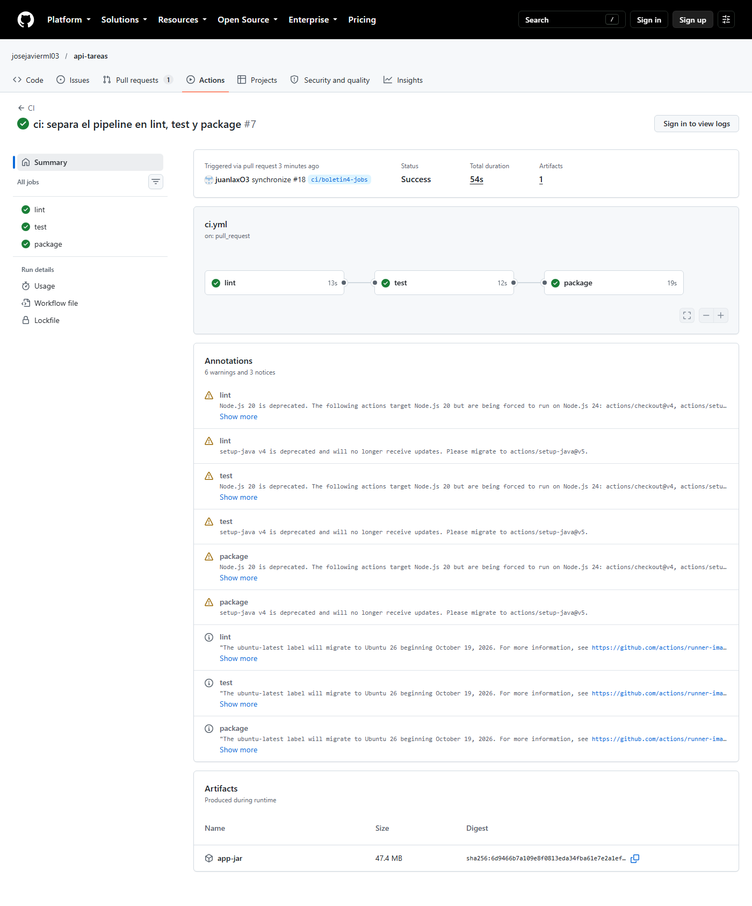

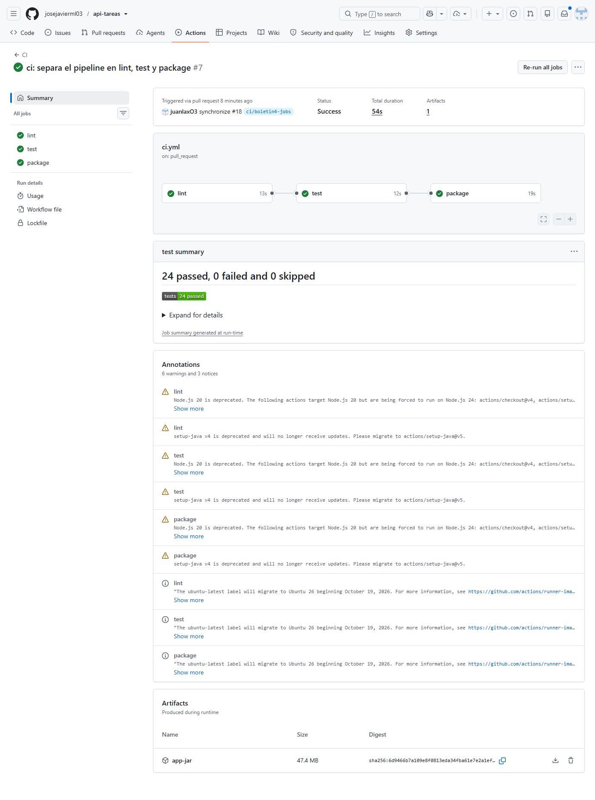

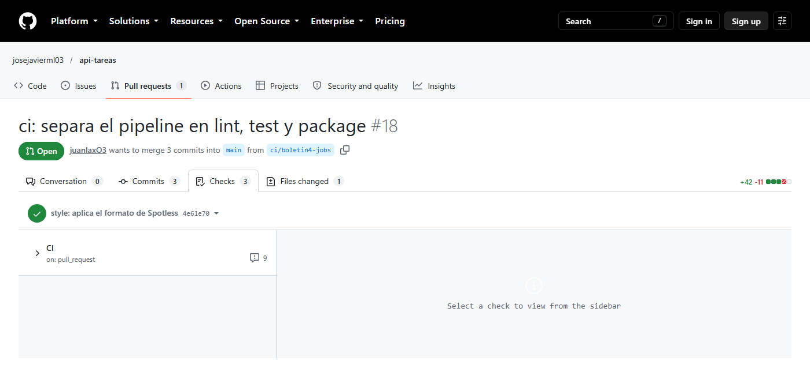

#### Por qué `lint` va primero

Es la comprobación más barata: solo compara el formato de los fuentes con Spotless, sin compilar. Al ir primero, un error de formato se detecta en segundos y **no se consumen minutos de runner** en `test` y `package`, que tardan mucho más. Y como van encadenados con `needs`, si `lint` falla los otros dos jobs ni siquiera arrancan.

#### Por qué el informe lleva `if: always()`

Por defecto un paso se salta si uno anterior del job ha fallado, y justo cuando algo falla es cuando interesa ver qué test ha roto y por qué. `if: always()` ignora el resultado previo, así que el informe se publica también con `Tests` en rojo (con `fail-on-error: true` el paso termina en rojo, que es lo correcto: refleja el estado real).

#### Por qué `package` vuelve a construir el proyecto

Cada job se ejecuta en una **máquina virtual nueva y limpia**: el workspace de `test` desaparece al terminar, no hay `target/` compartido entre jobs. Por eso `package` no puede recoger el JAR ya generado y tiene que hacer `mvn -B package -DskipTests`. La caché de Maven (`cache: maven` en `setup-java`) evita descargar dependencias, pero no comparte la compilación.

#### Cómo se podrían compartir los archivos entre jobs

Con `actions/upload-artifact@v4` y `actions/download-artifact@v4`:

```yaml
  test:
    steps:
      - uses: actions/upload-artifact@v4
        with: { name: app-jar, path: target/*.jar }

  package:
    needs: test
    steps:
      - uses: actions/download-artifact@v4
        with: { name: app-jar, path: target }
```

`test` sube el JAR y `package` lo descarga: se ahorra la compilación y se paga el coste de subir y descargar el artefacto (~47 MB). El workflow actual prefiere reconstruir, que es más simple y muy rápido con la caché de Maven, y conserva `upload-artifact` para que el JAR sea descargable desde la ejecución.

### 4. `test: rompe un test para comprobar la proteccion de main` (parte D, sin fusionar)

- **Qué se hizo:** se configuró la protección de `main` desde la cuenta propietaria y se abrió un [PR #20](https://github.com/josejavierml03/api-tareas/pull/20) con un test roto para verificar que GitHub impide fusionarlo. El PR se **cerró sin fusionar** una vez capturada la evidencia.
- **Autor:** Juan Antonio.
- **Relación con el boletín:** parte D.
- **Configuración aplicada en Settings → Branches sobre `main`:**
  - *Require a pull request before merging* con 1 aprobación.
  - *Require status checks to pass before merging* con `lint`, `test` y `package`.
  - *Require branches to be up to date before merging*.
  - *Do not allow bypassing the above settings*.
- **Verificado:** el [PR #20](https://github.com/josejavierml03/api-tareas/pull/20) tenía la aprobación de `josejavierml03` («Changes approved») y, aun así, GitHub muestra «Some checks were not successful» con `test` en rojo marcado como **Required** y el botón **Squash and merge** deshabilitado. Estado del PR por API: `reviewDecision: APPROVED` y `mergeStateStatus: BLOCKED`. El fallo real fue `TaskServiceTest.createsTaskWithGeneratedId:31 expected: <Titulo incorrecto> but was: <Preparar la practica>`, con `lint` en verde y `package` en skipped.

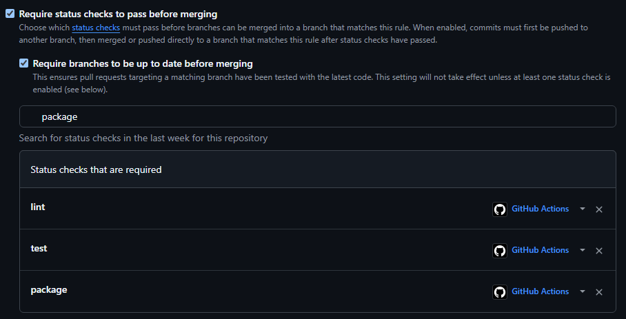

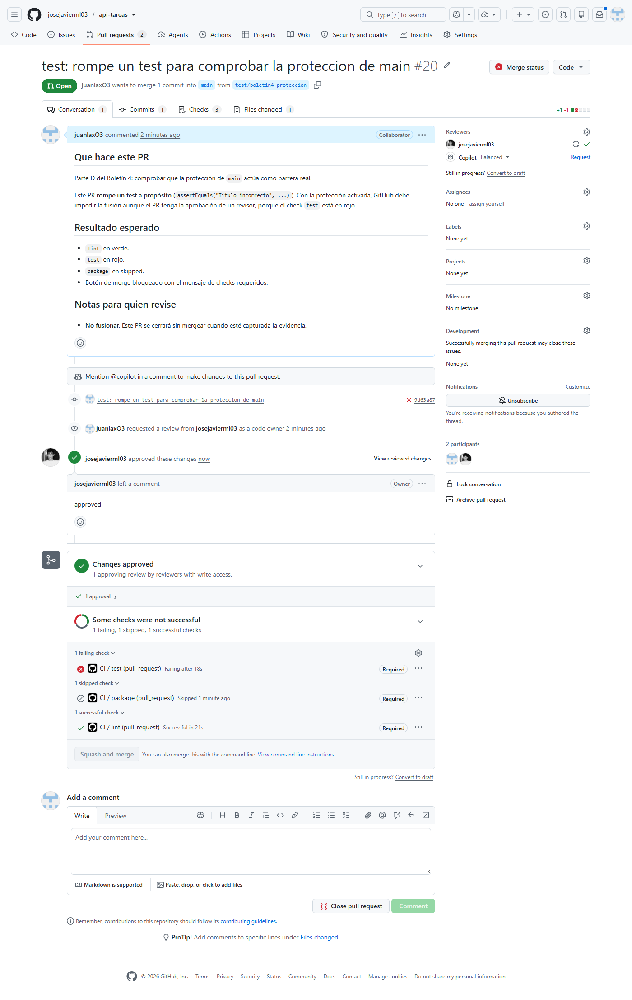

También se comprobó la opción *Require branches to be up to date before merging*: al fusionar otros cambios en `main`, el [PR #19](https://github.com/josejavierml03/api-tareas/pull/19) pasó a `mergeStateStatus: BEHIND` y GitHub exigió actualizar la rama antes de permitir la fusión.

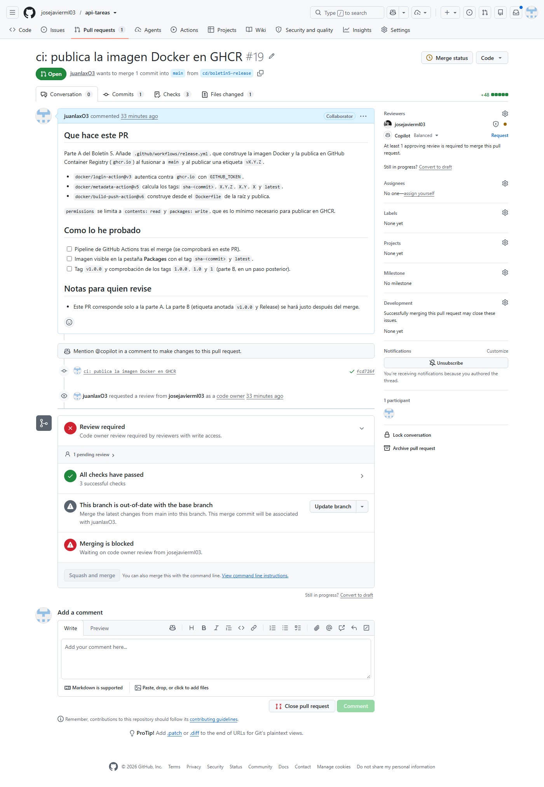

### 5. `ci: revisa los pull requests con IA y anade badges` (parte E)

- **Qué se hizo:** se añadió `.github/workflows/ai-review.yml`, que se ejecuta en cada pull request (`opened`, `synchronize`, `reopened`) y:
  1. Calcula el diff contra la rama base (`git diff origin/<base>...HEAD`) y lo recorta a 60 000 caracteres para no pasarse de contexto.
  2. Llama a **Ollama Cloud** (`https://ollama.com/api/chat`) con `curl`, usando el modelo gratuito `gpt-oss:120b` y autenticándose con el secreto `OLLAMA_API_KEY`.
  3. Publica un comentario con el resumen en lenguaje natural. Si el comentario ya existe (se busca el marcador `<!-- ai-review -->`), lo actualiza en lugar de duplicarlo.
  4. Si cualquier paso falla, el comentario dice literalmente **«La IA ha fallado»**.

  Se añadieron además los badges de `ci.yml` y `release.yml` al README. Los commits internos fueron `bc0ff84` (workflow y badges) y `eecbc29` (cambio de modelo a uno gratuito).
- **Autor:** Juan Antonio.
- **Relación con el boletín:** parte E (gestión de secretos y badge del CI).
- **Uso de IA:** OpenCode, MiMo-V2.6-Pro. Petición: «Workflow de revisión con IA en cada PR, con el token en secretos y "La IA ha fallado" si hay error». El resumen del PR lo genera a su vez otra IA (`gpt-oss:120b` de Ollama Cloud) a partir del diff.
- **Alcance de la consulta (elaboración, no cita literal):** automatizar un resumen legible de los cambios de cada PR, obtener el token de un secreto de GitHub Actions, actualizar el comentario existente y mostrar el mensaje de fallo indicado cuando la llamada no funcione. Se añadieron también badges al README.

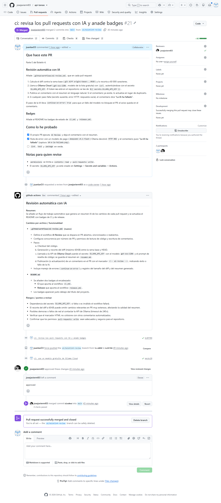

#### Gestión de secretos

La API key de Ollama **no está en el repositorio** ni en el historial. Se creó en **Settings → Secrets and variables → Actions → New repository secret** con nombre `OLLAMA_API_KEY`, y el workflow la lee como `${{ secrets.OLLAMA_API_KEY }}`. GitHub la inyecta en el entorno del paso y la enmascara en los logs (aparece como `***`).
