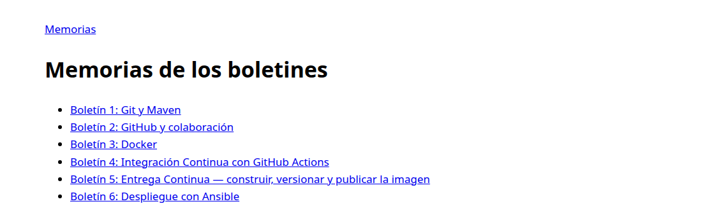
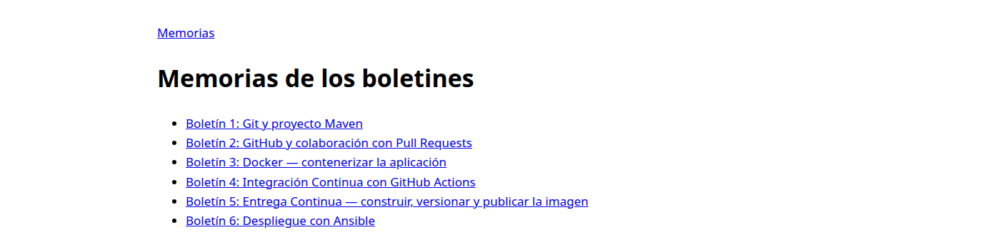
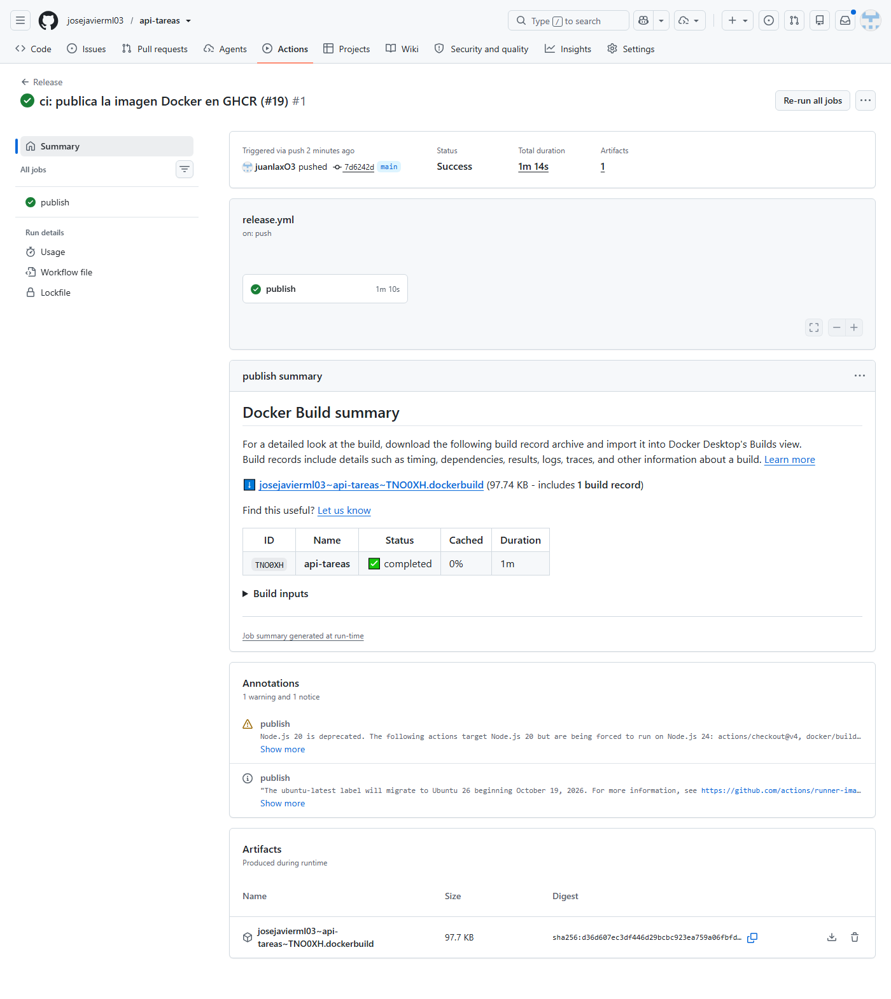
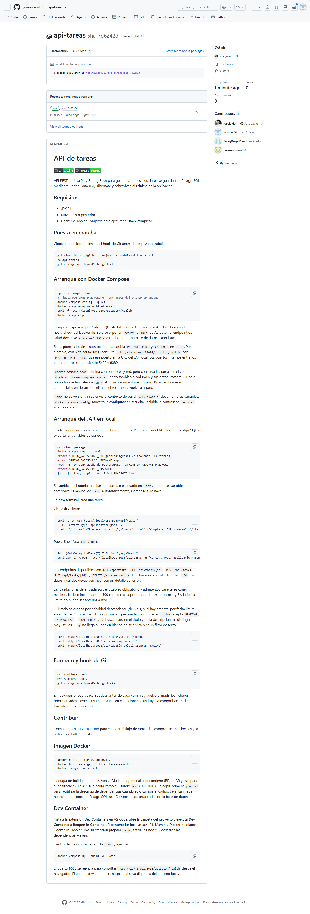
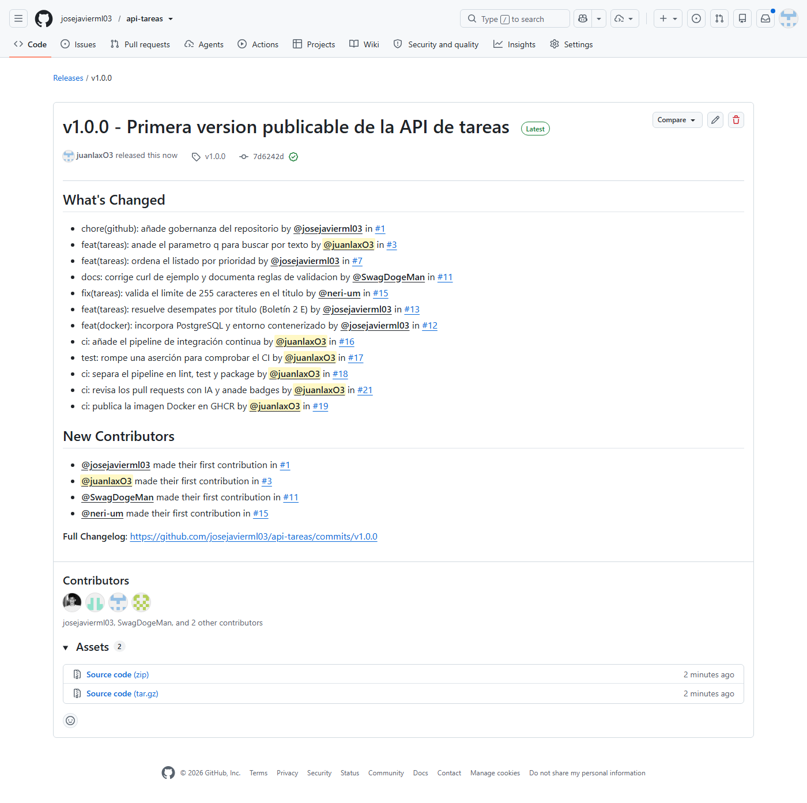
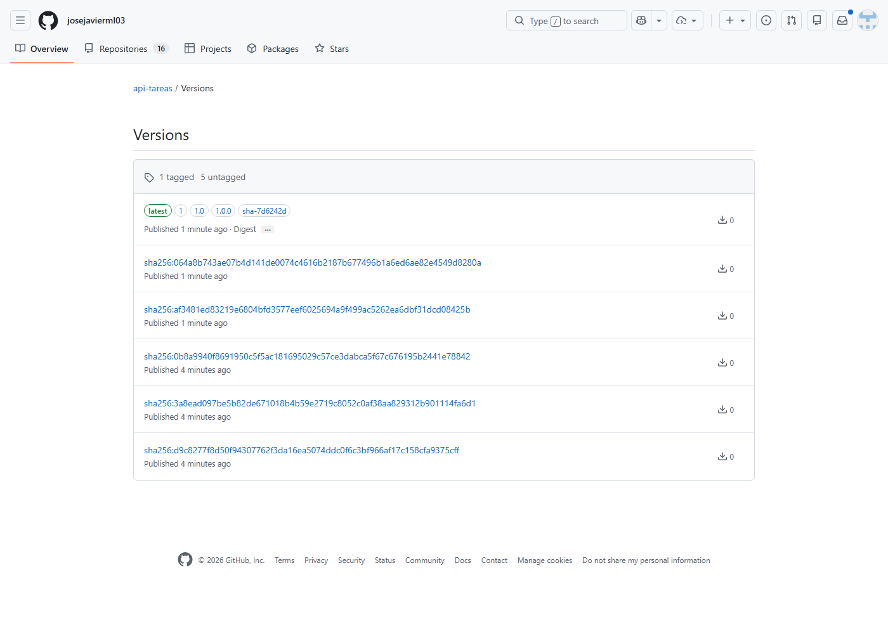
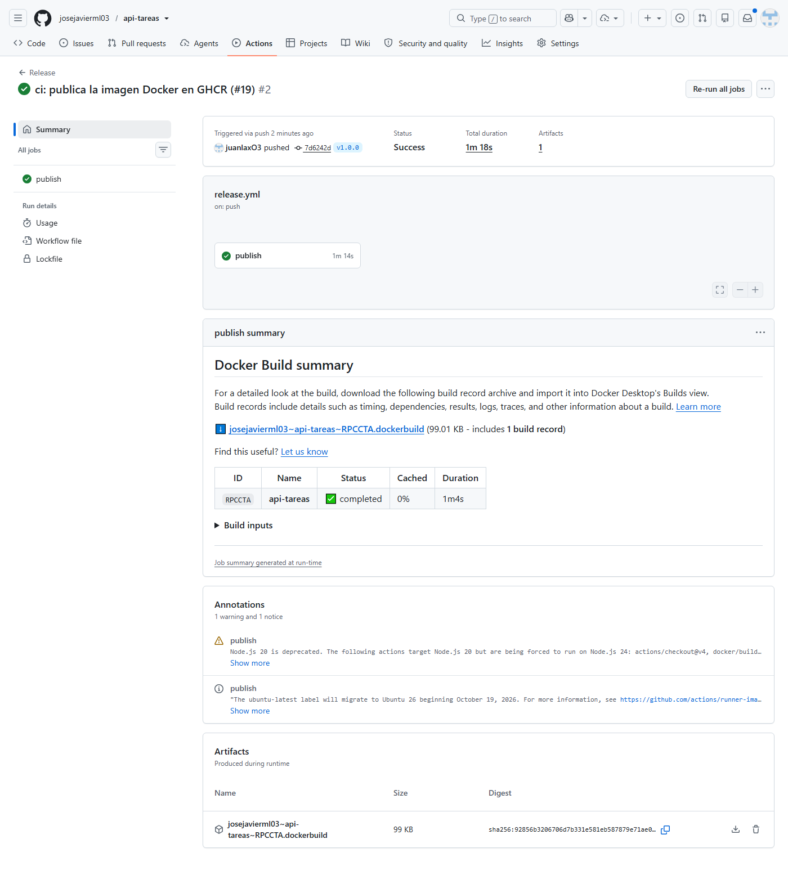

# Boletín 5: Entrega Continua — construir, versionar y publicar la imagen

## Ampliación de esta sesión: partes C–D

Se ha verificado la imagen `ghcr.io/josejavierml03/api-tareas:1.0.0` al descargarla en las dos máquinas app del laboratorio Ansible, conectadas por red a PostgreSQL en db1. Las dos devolvieron salud UP. Se generaron `docs/boletin1.md` a `docs/boletin6.md`, script Python `docs/build.py` y workflow oficial de Pages. Se configuró Source = GitHub Actions mediante API. El PR #22 ya está fusionado y la [ejecución de Pages 41305291783](https://github.com/josejavierml03/api-tareas/actions/runs/41305291783) terminó correctamente. La web se ha abierto y comprobado en su URL pública.

El script convierte tablas, bloques de código y enlaces, genera índice y copia capturas/diagrama al sitio. `docs/site/` queda ignorado. IA: OpenCode GPT-6.1-sol, «Implementa todo lo que falta de los boletines». Se probaron build local y los despliegues reales.

**Alcance de la consulta (elaboración, no cita literal):** revisar las memorias disponibles, incorporarlas a `docs/` y generar una web navegable con un índice y una página por boletín. Se preparó además un workflow con las acciones oficiales de GitHub Pages y se comprobó localmente que se copiaban las capturas y que los enlaces funcionaban.





Nota sobre etiquetas: `latest` se habilita mediante `{{is_default_branch}}`; no debe asumirse que un evento de tag lo vuelve a publicar solo por apuntar a un commit de main. Los tags SemVer completos y SHA identifican la versión; `1`/`1.0` son canales móviles y no se usan para rollback.

Repositorio: <https://github.com/josejavierml03/api-tareas>.

## Resumen de commits

| # | Mensaje | Qué se hizo | Autor | Enlace |
|---|---|---|---|---|
| 1 | `ci: publica la imagen Docker en GHCR` | Workflow `release.yml` que construye la imagen Docker y la publica en `ghcr.io` al fusionar en `main` y al publicar una etiqueta de versión. | Juan Antonio | [7d6242d](https://github.com/josejavierml03/api-tareas/commit/7d6242d) |
| 2 | `v1.0.0` (etiqueta anotada) | Primera versión publicable: etiqueta SemVer y Release de GitHub con notas generadas. | Juan Antonio | [v1.0.0](https://github.com/josejavierml03/api-tareas/releases/tag/v1.0.0) |

## Detalle por commit

### 1. `ci: publica la imagen Docker en GHCR` (parte A)

- **Qué se hizo:** se creó `.github/workflows/release.yml`, que se dispara en `push` a `main` y en `push` de etiquetas `v*.*.*`. El job `publish` hace:
  1. `actions/checkout@v4`.
  2. `docker/login-action@v3` contra `ghcr.io`, con `github.actor` y `secrets.GITHUB_TOKEN`.
  3. `docker/metadata-action@v5` para calcular los tags de la imagen.
  4. `docker/build-push-action@v6`, que construye el `Dockerfile` de la raíz y publica con los tags y etiquetas OCI generadas en el paso anterior.

  El bloque `permissions` se reduce a `contents: read` y `packages: write`, que es lo mínimo necesario para publicar en el registro. Se añadió también `concurrency` agrupado por ref con `cancel-in-progress: false`, para que dos publicaciones simultáneas no se cancelen entre sí.
- **Autor:** Juan Antonio.
- **Relación con el boletín:** parte A.
- **Verificado:** run [40385988200](https://github.com/josejavierml03/api-tareas/actions/runs/40385988200) en verde en 1 min 10 s. La imagen aparece en la pestaña **Packages** del repositorio como [`api-tareas`](https://github.com/josejavierml03/api-tareas/pkgs/container/api-tareas).





#### 1) Al fusionar un PR a `main`

El evento es un `push` a la rama `main`, **sin etiqueta git**. Por eso:

- `type=sha,prefix=sha-` genera **`sha-7d6242d`**, la trazabilidad absoluta: de la imagen al commit exacto que la produjo.
- Las tres reglas `type=semver` **no generan nada**, porque no hay ninguna etiqueta `vX.Y.Z` asociada al push; esas reglas solo se activan cuando `github.ref` es una etiqueta SemVer válida.
- `type=raw,value=latest` se activa porque estamos en la rama por defecto, así que se publica **`latest`**.

Resultado: `ghcr.io/josejavierml03/api-tareas:sha-7d6242d` y `:latest`.

#### 2) Al publicar la etiqueta `v1.0.0`

El evento es un `push` de una etiqueta que cumple el patrón `v*.*.*`, así que las reglas SemVer se activan y extraen la versión `1.0.0` de `v1.0.0`:

- `type=semver,pattern={{version}}` → **`1.0.0`** (versión completa, para despliegues concretos).
- `type=semver,pattern={{major}}.{{minor}}` → **`1.0`** (canal de la serie 1.0; recoge parches).
- `type=semver,pattern={{major}}` → **`1`** (canal de la versión mayor).
- `type=sha,prefix=sha-` → **`sha-7d6242d`**, igual que antes: la trazabilidad se conserva en todas las publicaciones.
- `type=raw,value=latest,enable={{is_default_branch}}` no garantiza publicar `latest` en un evento de tag; ese canal ya lo publicó el push a main.

Resultado del tag: `1.0.0`, `1.0`, `1` y `sha-7d6242d`; `latest` procede del evento de main. Aunque el código fuente sea el mismo, no se presupone que dos builds separados tengan idéntico digest. Es la diferencia entre *versionar* (SemVer) y *trazar* (SHA).

### 2. `v1.0.0` (parte B)

- **Qué se hizo:** se creó la etiqueta **anotada** `v1.0.0` sobre el commit `7d6242d` y se subió al remoto:

  ```bash
  git tag -a v1.0.0 -m "Primera version publicable de la API de tareas" 7d6242d
  git push origin v1.0.0
  ```

  El push de la etiqueta disparó de nuevo `release.yml` y publicó la imagen con los tags SemVer. Después se creó la **Release** de GitHub a partir de esa etiqueta, con título, notas generadas automáticamente por GitHub y el enlace al cambio.
- **Autor:** Juan Antonio.
- **Relación con el boletín:** parte B.
- **Uso de IA:** OpenCode, MiMo-V2.6-Pro. Petición: «Etiqueta v1.0.0 y release». La release se creó con `gh release create v1.0.0 --verify-tag --generate-notes`.
- **Alcance de la consulta (elaboración, no cita literal):** crear y publicar una etiqueta anotada `v1.0.0`, comprobar que el workflow de Release se disparaba y generaba etiquetas SemVer y SHA en GHCR, y crear la Release de GitHub con notas generadas.
- **Verificado:** run [40386370211](https://github.com/josejavierml03/api-tareas/actions/runs/40386370211) en verde. Tags publicados: `1.0.0`, `1.0`, `1`, `sha-7d6242d` y `latest`. Release: <https://github.com/josejavierml03/api-tareas/releases/tag/v1.0.0>.






