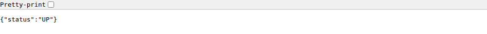
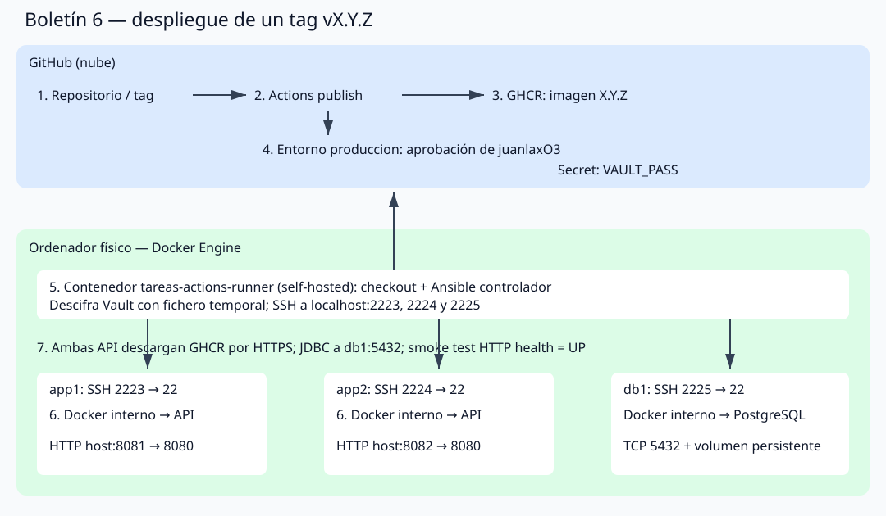
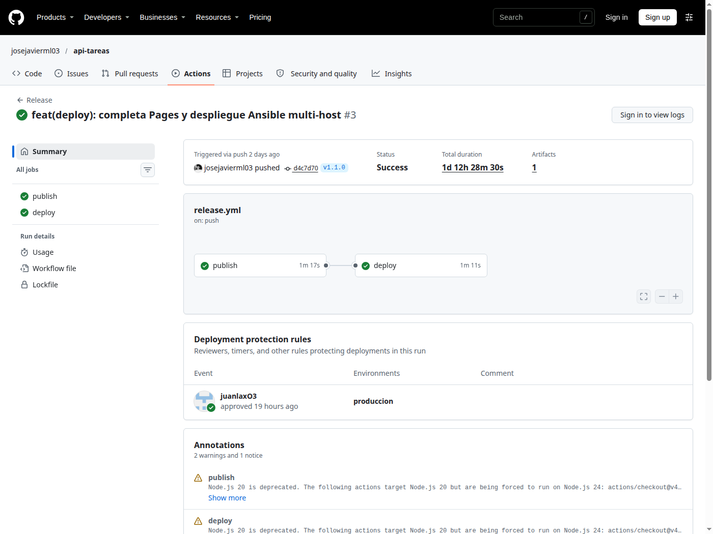
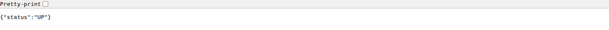
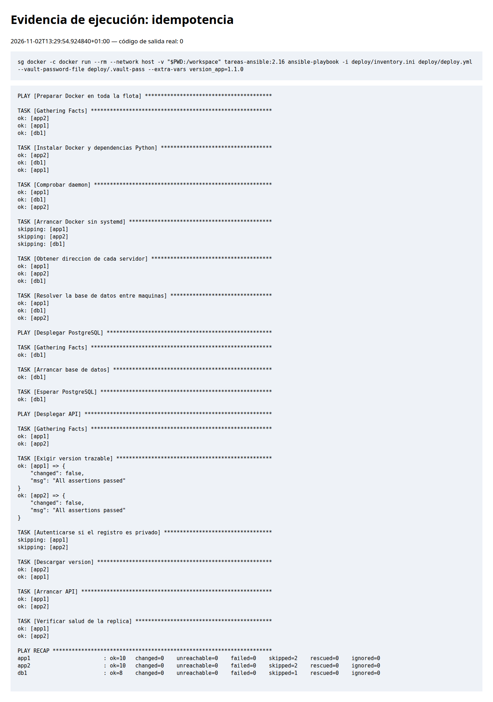

# Boletín 6: Despliegue con Ansible

## Resumen de cambios de esta sesión

| Mensaje previsto | Qué se hizo | Autor | Referencia |
|---|---|---|---|
| `feat(deploy): completa Pages y despliegue Ansible multi-host` | Flota, controlador, Vault, runner y automatización protegida; memorias y generador Pages | José Javier Méndez | [d4c7d70](https://github.com/josejavierml03/api-tareas/commit/d4c7d70) |
| `fix(devcontainer): fija Java 21 y registra pruebas de despliegue` | Entorno Java/Maven fijado y probado; smoke test, resultados de 1.1.0 y rollback, capturas y validación Pages en PR | José Javier Méndez | [PR #22](https://github.com/josejavierml03/api-tareas/pull/22) |
| `docs: completa memorias y evidencias verificadas` | Ajusta tablas por commit y registra la validación final de documentación y CI | José Javier Méndez | [PR #22](https://github.com/josejavierml03/api-tareas/pull/22) |
| `fix(runner): reutiliza la configuracion al reiniciar` | Corrige la reutilización del runner y actualiza las memorias con las comprobaciones actuales | José Javier Méndez | [3f93412](https://github.com/josejavierml03/api-tareas/commit/3f93412) |
| `docs: añade capturas reales de los boletines` | Incorpora 21 capturas de GitHub, API, Docker y pruebas de despliegue | José Javier Méndez | Rama `docs/capturas-boletines` |

## Detalle del cambio

La sesión añade los archivos de `deploy/`, amplía Release con `needs: publish`, entorno `produccion` y runner self-hosted, y publica las memorias desde `docs/`. Se revisaron los cambios y se probaron el despliegue y la idempotencia. IA: OpenCode, GPT-6.1-sol, petición «Implementa todo lo que falta de los boletines».

**Alcance de la consulta (elaboración, no cita literal):** revisar los boletines y el estado real de GitHub antes de completar el trabajo pendiente. Para el despliegue se preparó una flota de dos servidores de aplicación y uno de base de datos, inventario, playbook y Vault; se conectó el despliegue a la publicación de versiones mediante un runner autoalojado y un entorno con revisión. La comprobación incluyó salud, persistencia compartida, idempotencia, actualización y rollback, documentando las aprobaciones que debían realizar otras personas.

## A — Dependencias reproducibles

Ansible-core 2.16.14 y community.docker 3.7.0 en una imagen controladora Python 3.12, con sshpass. No se necesita instalar herramientas globales en el host. Dependencia declarada en `deploy/requirements.yml`.

## B–C — Flota SSH e inventario

Tres máquinas simuladas con Ubuntu 24.04 y SSH: app1 (2223), app2 (2224), db1 (2225). Se usa Ubuntu actual en lugar de 18.04. Docker se ejecuta dentro de cada máquina privilegiada; el controlador solo conecta por SSH. Los puertos de API son 8081 y 8082. La conexión Ansible devolvió `pong` desde los tres hosts.

## D–E — Playbook y Vault

Se comprueba/arranca Docker sin systemd, se despliega PostgreSQL con volumen y healthcheck y después las dos API desde GHCR. Cada API resuelve db1 mediante su dirección real, compartiendo la red de su máquina simulada. Se esperan salud de base de datos y UP en ambas API. Se rechaza `latest` para desplegar siempre una versión trazable.

`deploy/group_vars/servidores/vault.yml` está cifrado con Ansible Vault (cabecera `$ANSIBLE_VAULT;1.1;AES256`). Contraseña maestra aleatoria local en `deploy/.vault-pass`, ignorada y con permiso 600, y en el secreto del entorno `produccion`. No se pasan credenciales mediante argumentos; las tareas con datos sensibles usan `no_log`.

## F — Ejecución y pruebas

Primera ejecución real de `version_app=1.0.0`:

```text
app1: changed=4 unreachable=0 failed=0
app2: changed=4 unreachable=0 failed=0
db1:  changed=3 unreachable=0 failed=0
```

Segunda ejecución real, misma versión:

```text
app1: changed=0 unreachable=0 failed=0
app2: changed=0 unreachable=0 failed=0
db1:  changed=0 unreachable=0 failed=0
```

`http://localhost:8081/actuator/health` y `http://localhost:8082/actuator/health` devolvieron `{"status":"UP"}`. La primera descarga de `ghcr.io/josejavierml03/api-tareas:1.0.0` se realizó desde los servidores sin autenticación por ser pública.




Se publicó la etiqueta anotada y [Release v1.1.0](https://github.com/josejavierml03/api-tareas/releases/tag/v1.1.0). [Publish](https://github.com/josejavierml03/api-tareas/actions/runs/41254644207) terminó correctamente y generó la imagen 1.1.0. Se desplegó manualmente: `changed=2` en cada app y `changed=0` en db1. Las dos réplicas quedaron UP.

Después se volvió a 1.0.0: `changed=1` en cada app, `changed=0` en db1 y **27,27 segundos** para el playbook completo, menos de un minuto. `python3 deploy/smoke.py` pasó tras actualización y rollback: crea una tarea en app1, la recupera en app2 y la elimina. Esto comprueba que ambas comparten realmente la misma base de datos. El script se añade como segundo cambio de esta sesión y solo utiliza datos temporales de prueba.

## G — Pipeline y arquitectura

Runner local construido con la distribución oficial Actions Runner 2.338.2, Ansible 2.16.14 y sshpass; registrado como `tareas-local`, estado online. El runner solo recibe el despliegue para tags después de `publish`, condicionado al entorno `produccion`. Se configuró como revisor a `juanlaxO3` y se creó el secreto `VAULT_PASS`. Solo se permiten despliegues de tags `v*`.



1. El estudiante inicia HTTPS al hacer push de `vX.Y.Z`.
2. GitHub ejecuta publish en un runner alojado y construye la imagen.
3. Publish sube por HTTPS a GHCR con tags trazables y devuelve la versión.
4. GitHub solicita aprobación del entorno antes de entregar el job deploy.
5. El runner del ordenador mantiene una conexión HTTPS saliente a GitHub, recibe el job, descarga el código y descifra Vault temporalmente.
6. Ansible inicia SSH hacia los tres servidores; sus Docker internos descargan imágenes por HTTPS y arrancan PostgreSQL y API.
7. Las API conectan por JDBC/TCP a db1 y Ansible comprueba salud por HTTP en cada máquina.

El workflow de v1.1.0 llegó inicialmente a `deploy`, estado waiting, con `produccion` y revisor `juanlaxO3`. Tras la aprobación, quedó en cola porque el ordenador y el runner estaban apagados. El 2 de noviembre se reactivó la flota y se corrigió un fallo real del entrypoint: intentaba registrar de nuevo un runner ya configurado. Ahora solo se solicita el token y se ejecuta config.sh si no existe `.runner`; en posteriores arranques se reutiliza la configuración y se ejecuta run.sh.

Tras reiniciar el runner, [la ejecución 41254644207](https://github.com/josejavierml03/api-tareas/actions/runs/41254644207) terminó con **publish y deploy correctos**. Ambas máquinas ejecutan `ghcr.io/josejavierml03/api-tareas:1.1.0`; el smoke test crea una tarea en app1, la recupera en app2 y la elimina. Un nuevo reinicio deja el runner online sin intentar registrarlo otra vez.






Se volvió a ejecutar el playbook con la versión 1.1.0 para obtener la evidencia de idempotencia: changed=0, unreachable=0 y failed=0 en los tres hosts. La captura presenta la salida real de esa ejecución en una vista de evidencias:



## Verificación final de la documentación

Tras aportar el estudiante `memoria-boletin1.md`, `memoria-boletin2.md` y `memoria-boletin3.md`, se incorporaron sus detalles originales, autores, prompts y declaraciones de IA a `docs/`, conservando las comprobaciones posteriores. Se actualizaron los estados antiguos de los PR y se documentó la contribución externa aprobada. Los originales de la raíz se conservan sin modificar. Al no estar disponibles las capturas originales, se obtuvieron nuevas capturas de comprobación, identificadas como actuales en las memorias.

La generación local produjo seis memorias y un índice; se comprobó que todos sus enlaces e imágenes locales existen. El [workflow Pages del PR](https://github.com/josejavierml03/api-tareas/actions/runs/41256112191) construyó correctamente un artefacto `github-pages` de 2.490.970 bytes y omitió el despliegue por tratarse de un PR. El CI [41256112075](https://github.com/josejavierml03/api-tareas/actions/runs/41256112075) completó lint, test y package correctamente. Tras fusionar #22, Pages se publicó correctamente con la ejecución 41305291783.

**IA de la sesión de capturas y corrección del reinicio:** OpenCode, GPT-6.1-sol. Petición: «Obten las capturas, y que mas falta?». Se obtuvieron imágenes de páginas reales y salidas reales de comandos; se probaron bash -n, reinicio del runner, despliegue automático y smoke test.

**Alcance de la consulta (elaboración, no cita literal):** obtener evidencias de los ejercicios que podían repetirse o consultarse, distinguir las capturas actuales de las históricas y revisar los PR y ejecuciones pendientes. Durante la comprobación se detectó y corrigió que el runner intentaba registrarse de nuevo al reiniciar; después se verificaron el despliegue y la comunicación entre réplicas.
